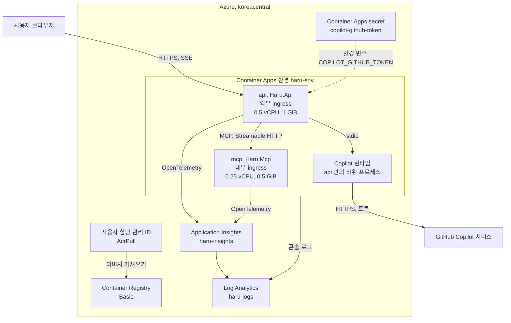
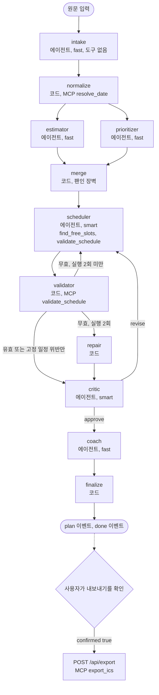

# 하루설계(Haru) 기술 요구 문서(TRD)

2026 청도 바이브코딩 해커톤 제출 문서이다. 기준일은 2026-11-05이다. 제품 요구는 [PRD.md](PRD.md), 결정의 이유는 [TDD.md](TDD.md), API 계약은 [docs/api-contract.md](docs/api-contract.md)에 있다. 코드로 확인하지 못한 항목에는 "예정" 또는 "추정"을 붙였다.

## 1. 개요
- 목적: 사용자가 붙여 넣은 거친 메모를 충돌 없는 하루 시간표로 바꾼다. 에이전트 단계를 SSE(Server-Sent Events, 서버가 보내는 이벤트 스트림)로 실시간으로 보여 주고, 사용자가 확인한 뒤에만 `.ics`(iCalendar) 파일을 내보낸다.
- 구성: 서비스 2개, `Haru.Api`(웹 앱과 워크플로 실행)와 `Haru.Mcp`(도구 서버)이다. 데이터베이스와 로그인이 없다. Azure Container Apps(koreacentral)에서 실행한다. 2026-11-05에 배포했다(7장). 주소는 https://api.proudbush-c0263160.koreacentral.azurecontainerapps.io 이다.
- 기술: .NET 10, ASP.NET Core 최소 API, Microsoft Agent Framework(MAF) `Microsoft.Agents.AI.Workflows` 1.27.0과 `Microsoft.Agents.AI.GitHub.Copilot` 1.27.0, `GitHub.Copilot.SDK` 1.0.28, Model Context Protocol(MCP) `ModelContextProtocol` 2.3.1, Aspire 13.6.4, 바닐라 HTML·CSS·JS(`src/Haru.Api/wwwroot`)이다.

## 2. 시스템 구성

계층을 섞지 않는다. 계층마다 한 곳에만 둔다.
- 모델(LLM, 대규모 언어 모델): GitHub Copilot 서비스가 제공한다. 이름은 `HARU_MODEL_FAST`, `HARU_MODEL_SMART`로 바꾼다.
- 에이전트: 역할, 모델 등급, 허용 도구를 정의한다. `src/Haru.Api/Agents/AgentCatalog.cs`
- 지침: 에이전트별 지시문이다. `prompts/<에이전트>.md` 파일이 없으면 api가 시작하지 않는다.
- 도구: 순수 함수를 담은 별도 MCP 서버이다. `src/Haru.Mcp`
- 워크플로: 에이전트와 코드 단계를 잇는다. `src/Haru.Api/Workflow/PlanWorkflow.cs`

## 3. 데이터와 API 요약
- 경로: `GET /api/config`(한도, `aiAvailable`), `POST /api/plan`(응답은 SSE 스트림), `GET /api/sample`(샘플 입력·결과, 기록된 실행 `events`), `POST /api/export`(`text/calendar`, `confirmed: true` 필요), `GET /health`, `GET /alive`이다. 필드와 오류 형식은 [docs/api-contract.md](docs/api-contract.md)가 정한다.
- 한도: 입력 3,000자, 본문 64 KB, IP당 10분에 8회, 동시 계획 3개, 하루 250회(한국 표준시 KST), 계획 120초, 에이전트 호출 60초이다. 환경 변수로 바꾸는 값은 `HaruOptions.cs`에 있다.
- 저장: 서버 코드에 데이터베이스가 없다. 사용 한도 계수는 메모리에만 둔다. 브라우저가 입력과 마지막 결과를 `localStorage`(`haru.v1`)에 저장하고 `지우기` 버튼이 지운다. Copilot 런타임이 남기는 파일은 9장에 있다.
- 도구 이벤트: 호출과 결과에 같은 `callId`를 넣는다. UI는 이 값으로 병렬 호출의 결과를 연결한다. 기록된 샘플에도 식별자를 넣는다.
- 동시 실행 한도(`BUSY`, 503): UI가 5초 간격으로 최대 12번 다시 요청한다. 기다리는 동안 안내 배너와 "대기 중" 상태를 보여 주고, `중지`로 멈출 수 있다. 12번 뒤에도 `BUSY`이면 아래 대체 경로로 간다.
- AI를 쓸 수 없을 때: 입력 오류(`INPUT_EMPTY`, `INPUT_TOO_LONG`, `BAD_REQUEST`)와 `NO_TASKS`를 뺀 모든 오류에서 UI가 `GET /api/sample`을 불러온다. 항상 "내 입력으로 만든 결과가 아닙니다"를 함께 보여 준다.
  - 기록된 실제 실행(`sample-run.json`, SSE 이벤트 37개)이 있으면 재생한다. 배지는 "기록된 실행 재생 · AI 호출 없음"이다. `smoke_plan.py --save`가 기록을 만든다. 기록 파일이 있으면 api가 시작할 때 `plan`·`done` 이벤트가 있고 `error` 이벤트가 없는지 검사한다. 어긋나면 시작하지 않는다.
  - 기록이 없으면 정적 샘플(`meta.source = offline-sample`)을 보여 준다. 배지는 "오프라인 샘플 · AI 호출 없음"이다.

## 4. 에이전트 설계
에이전트 6개와 코드 단계 5개가 한 워크플로를 이룬다. 정의는 `AgentCatalog.cs`, 지침은 `prompts/<에이전트>.md`에 있다.

| 에이전트 | 역할 | 등급(노력) | 도구 | 실패 시 |
|---|---|---|---|---|
| intake | 항목 30개 이하로 추출한다. 원문을 보는 유일한 에이전트이다 | fast(low) | 없음 | 중단 |
| estimator | 소요 시간 5~240분(5분 단위) | fast(low) | 없음 | 30분 |
| prioritizer | 우선순위 1~3 | fast(low) | 없음 | 우선순위 2 |
| scheduler | 시작 시각을 제안한다 | smart(medium) | `find_free_slots`, `validate_schedule` | 중단 |
| critic | 사전 부검으로 위험을 3개 이하 찾고 `approve` 또는 `revise`를 낸다 | smart(low) | 없음 | 승인, 위험 없음 |
| coach | 요약 3문장, 300자 이하 | fast(low) | 없음 | 규칙 기반 요약 |

- 코드 단계: normalize(MCP `resolve_date`로 날짜·시간 표현을 계산), merge(합류 장벽), validator(MCP `validate_schedule`), repair, finalize이다. "중단"은 SSE 오류 `NO_TASKS`, `WORKFLOW_FAILED`, `TIMEOUT` 중 하나이다. 사용자는 다시 시도할 수 있다.
- 모델: fast는 `claude-haiku-5.5`, smart는 `claude-sonnet-5.5`이다. 노력은 `HARU_EFFORT_FAST`(기본 low)와 `HARU_EFFORT_SMART`(기본 medium)로 바꾼다. critic은 smart 모델을 낮은 노력으로 실행한다. 검토 범위가 결함 3가지로 좁아서 이렇게 정했고, 이 단계는 실측 4~6초이다(TDD 7).
- 호출마다 새 세션을 만들고 도구 호출을 최대 8회로 제한한다. intake 뒤에는 정제한 구조화 필드(제목 80자, 메모·이유 120자, 항목 30개)만 넘긴다. 형식이 틀린 출력은 거절 이유를 붙여 한 번 다시 요청한다. 모르는 ID와 중복 ID는 버린다.

## 5. Copilot SDK와 워크플로
### 5.1 Copilot SDK 연결
- `CopilotClient` 하나를 모든 요청이 공유한다. 모드는 `CopilotClientMode.Empty`이다. 이 모드는 `BaseDirectory`와 세션별 `AvailableTools`를 직접 정해야 한다. SDK 문서는 이 모드를 다중 사용자 서버용으로 설명한다.
- 인증은 환경 변수 `COPILOT_GITHUB_TOKEN`이다. Copilot Requests 권한을 준 세분화된 개인 액세스 토큰을 쓴다. 값이 비었거나 `unset`이면 AI를 끈다.
- 전송은 표준 입출력(stdio)이다. 호출마다 `SessionConfig`를 새로 만든다. 시스템 메시지는 `Replace` 모드이고 허용 목록의 도구만 연다. 권한 처리기는 허용 목록의 사용자 정의 도구만 승인하고, 나머지는 거부한 뒤 기록한다.
- `.AsAIAgent(...)`가 세션을 MAF 에이전트로 바꾼다. OpenTelemetry 미들웨어는 `EnableSensitiveData=false`이다. 사용 이벤트의 실제 모델 이름을 `meta.models`에 담는다.
### 5.2 워크플로 그래프
`PlanWorkflow.cs`가 MAF `WorkflowBuilder`로 그래프를 만든다. `PlanService`가 `InProcessExecution.RunStreamingAsync`로 실행하고 단계마다 SSE 이벤트를 보낸다.

### 5.3 경로 선택 규칙
- validator: 결과가 유효하거나 고정 일정 위반만 남으면 critic으로 보낸다. 무효이고 scheduler 실행이 2회 미만이면 scheduler로 되돌린다. 무효이고 2회 실행했으면(`MaxSchedulerRuns = 2`) repair로 보낸다.
- repair: 충돌하는 작업 중 우선순위가 가장 낮은 것을 `deferred`로 옮긴다. 옮길 때마다 다시 검증하며 최대 10번 옮긴다.
- critic: 네 조건이 모두 맞을 때만 `revise`로 scheduler에 되돌린다. scheduler 실행이 2회 미만, 위반이 고정 일정만이 아님, 경과 시간 70초 이하, 수정 지시가 있음이다. 아니면 coach로 보낸다. 지침은 `revise` 사유를 결함 3가지로 제한한다.
- 패턴: 순차, 동시 실행(팬아웃은 갈라짐, 팬인은 합류), 반복, 조건 분기, 도구 호출(MCP), 컨텍스트 관리(불변 `PlanContext`, 호출마다 새 세션), 스트리밍(SSE), 사용자 확인(`confirmed: true`), 결정론적 가드레일(validator, repair)이다.

## 6. MCP 도구 계층
- `Haru.Mcp`는 MCP 서버이다. 전송은 Streamable HTTP(`/mcp`, 상태 없음)이다. 내부 ingress만 연다. 요청 본문은 512 KB 이하이다.
- 도구 4개는 순수 함수이다. 읽기 전용·멱등 어노테이션과 구조화 출력 스키마가 있다. 문자열은 200자 이하, 배열은 50개 이하이다. 잘못된 인수는 예외 대신 한국어 계약 결과로 돌려준다(`MalformedArgumentsFilter`).
  - `resolve_date`는 한국어 날짜·시간 표현을 엄격하게 해석한다(`expression` 60자 이하). `find_free_slots`는 빈 시간대를 찾는다. `export_ics`는 `.ics` 텍스트를 만든다.
  - `validate_schedule`은 OVERLAP, OUT_OF_HOURS, NO_BUFFER, OVERLOAD, DEADLINE_MISSED, INVALID_RANGE 6개 규칙을 검사한다. 기본 버퍼는 5분, 최대 부하는 0.85이다.
- `export_ics`는 어떤 에이전트의 허용 목록에도 없다. `POST /api/export`만 호출하며, `confirmed: true`와 재검증(`maxLoad = 1.0`)을 거친 뒤에 호출한다. 어노테이션이 아니라 허용 목록과 확인 절차가 이 도구를 지킨다.
- `McpGateway`는 연결 하나를 공유하고 끊기면 한 번 다시 연결한다. 주소는 `MCP_URL`, 서비스 디스커버리, `http://localhost:5258` 순으로 찾고 `/mcp`를 붙인다. 도구 로그에는 이름, 결과, 소요 시간만 남고 인수는 남지 않는다.

## 7. 인프라와 배포
- Aspire AppHost(`src/Haru.AppHost/Program.cs`)가 리소스를 정의하고 `aspire deploy`가 만든다. 지역은 `koreacentral`이다. 구독 정책이 `indiasouthcentral`, `koreacentral`, `uaenorth`, `indonesiacentral`, `eastasia`만 허용한다.
  - `api`: 외부 ingress(인터넷에서 접근), 0.5 vCPU, 1 GiB, 복제본 1~2개, 고정 세션, 단일 리비전이다.
  - `mcp`: 내부 ingress(환경 안에서만 접근), 0.25 vCPU, 0.5 GiB, 복제본 1~2개, 단일 리비전이다. 공개 주소가 없다.
  - 공용: Container Apps 환경 `haru-env`, Container Registry(Basic), 사용자 할당 관리 ID 1개(AcrPull), Log Analytics `haru-logs`, Application Insights `haru-insights`이다.
  - 상태 점검: 두 앱 모두 HTTP 프로브를 쓴다. liveness는 `/alive`(15초 주기, 제한 5초, 실패 5회), readiness는 `/health`(10초 주기, 제한 5초, 실패 3회)이다. 계획 1회가 CPU를 오래 쓰므로 liveness를 느슨하게 잡았다. 프로브 API(`WithHttpProbe`)는 Aspire 평가용 API이다.
  - 환경 모드: AppHost가 `environmentMode: WorkloadProfiles`(API 버전 `2026-03-02-preview`)를 직접 지정한다. 모드를 지정하지 않으면 이 구독에서 환경이 Express 모드로 만들어져 고정 세션(`ExpressStickySessionsNotSupported`)과 .NET 런타임 설정(`ExpressDotnetRuntimeNotSupported`)을 거부했다. 이미 만든 Express 환경은 바꿀 수 없어 지우고 다시 만들었다(TDD 14).
- 비밀값: 매개변수 `copilot-token`이 Container Apps secret `copilot-github-token`이 되고, api에만 환경 변수 `COPILOT_GITHUB_TOKEN`으로 들어간다. secret은 빈 값을 둘 수 없어 기본값이 `unset`이다. api는 `unset`을 토큰 없음으로 처리한다. Key Vault는 쓰지 않는다(TDD 5). 파일에는 비밀값을 쓰지 않는다.
  - 실제 토큰은 `scripts/set-copilot-token.sh`가 secret에 넣고 리비전을 다시 시작한다. 토큰은 표준 입력으로 `az`에 들어가며 명령줄 인수에 나타나지 않는다. `ghp_`, `gho_` 토큰은 거부한다. 두 번 붙여 넣은 값과 공백이 든 값도 거부한다. 다시 배포하면 secret이 `unset`으로 돌아가므로 배포 때 `Parameters__copilot-token`을 함께 넘기거나 스크립트를 다시 실행한다.
- 이미지: `linux-x64`, glibc 기반 `aspnet:10.0`이다. api 약 588 MB, mcp 약 238 MB이다(로컬 빌드 기준). NuGet 패키지가 Copilot CLI 런타임을 빌드 때 내려받으므로 빌드에 `github.com` 접속이 필요하다.
- 선행 조건: `az login`, 구독 소유자 권한, Docker, 리소스 공급자 5개 등록(Microsoft.App, ContainerRegistry, ManagedIdentity, OperationalInsights, Insights)이다.
- 배포 명령이다. 구독 ID는 실행할 때 입력하고 파일에 쓰지 않는다. 토큰을 함께 넣으려면 `Parameters__copilot-token`을 환경 변수로 더한다.
```bash
dotnet tool restore
env Azure__SubscriptionId=<구독 ID> Azure__Location=koreacentral Azure__ResourceGroup=rg-haru dotnet aspire deploy --clear-cache --non-interactive
```
- `--clear-cache`는 필수이다. 없으면 Aspire가 매개변수를 `~/.aspire/deployments/<해시>/production.json`에 평문으로 저장하고, 저장된 값이 환경 변수보다 앞선다.
- 배포 결과(2026-11-05): 28단계 모두 성공, 3분 31초. 첫 시도는 Express 한도로 실패했고, 환경 모드를 고정한 두 번째 시도가 성공했다. 확인한 것: `/health` 200, `/api/config`, `/api/sample`, 보안 헤더, 브라우저 UI 테스트 12건(`.ics` 내보내기 포함, 내부 `mcp` 호출 증명), Log Analytics의 `api`·`mcp` 행이다. 프로브(Liveness `/alive`, Readiness `/health`)를 더한 재배포(14:07, 1분 32초)도 성공했고, `/alive`·`/health`·보안 헤더·UI 테스트 12건을 다시 통과했다. 그 뒤 스크립트로 토큰을 넣었다. `aiAvailable`이 `true`가 되었고, Azure 배포본에서 `smoke_plan.py`가 실제 AI로 유효한 계획을 만들었다(39.4초, 39.3초, 부하 78%). 세션 삭제를 더한 재배포(15:05, 96초) 뒤에도 실제 AI 계획이 37.4초에 유효했다(부하 84%).
- 비용: 월 약 21~23달러(유휴, 약 하루 0.7달러)로 추정한다. 목록 가격이며 청구서는 확인하지 않았다. 지우려면 `az group delete -n rg-haru --yes`를 실행한다.

## 8. 관측과 운영
- 계측: `src/Haru.ServiceDefaults`가 OpenTelemetry를 설정한다. `APPLICATIONINSIGHTS_CONNECTION_STRING`이 있으면 Azure Monitor로, `OTEL_EXPORTER_OTLP_ENDPOINT`가 있으면 OTLP(OpenTelemetry Protocol)로 보낸다. 로컬에서는 AppHost가 Aspire 대시보드를 띄운다. `/health`와 `/alive`는 트레이스에서 뺀다.
- 트레이스: 활동 `haru.plan`(`run_id`, `outcome`, `scheduler_runs`, `tokens.input`, `tokens.output`), 에이전트 호출, MCP 호출(`Haru.Mcp.Client`), HTTP 요청이다. 지표는 `haru.plans`, `haru.tokens`, `haru.repairs`, `haru.plan.duration`, `haru.agent.duration`이다.
- 사용자 텍스트를 로그와 트레이스에 넣지 않는다(내용 수집 끔). 클라이언트 IP는 메모리의 사용 한도 계산에만 쓴다. 콘솔 로그는 Log Analytics로 간다.
- 점검 순서: `GET /api/config`의 `aiAvailable` 확인, `python3 tests/eval/smoke_plan.py --url <주소>` 실행, App Insights의 `outcome`과 `haru.agent.duration` 확인이다. `meta.models`가 설정과 다르면 모델이 바뀐 것이다.

## 9. 보안과 책임 있는 AI
프롬프트 주입(입력 속 명령으로 모델을 조종하는 공격)을 7겹으로 막는다.
1. 사용자 텍스트를 JSON으로 이스케이프한 데이터로 넘긴다. 지침이 데이터 속 명령을 무시하라고 지시한다(`AgentCaller`, `prompts/*.md`).
2. 도구가 없는 intake만 원문을 본다. 이후 에이전트는 정제한 필드(제목 80자, 메모·이유 120자)만 본다(`PlanWorkflow`, `PlanContext`).
3. 스키마 검증, 길이 제한, 제어 문자·너비 0 문자·양방향 제어 문자 제거를 적용한다(`TextSanitizer`).
4. 도구는 최소 권한의 순수 함수이다. 허용 목록 밖 도구 요청은 거부한다(`AgentCatalog`, 권한 처리기).
5. 결정론적 validator와 repair가 시간표를 다시 검사하고 고친다.
6. 부작용이 있는 유일한 동작인 ICS 내보내기는 사용자 확인과 재검증을 거친다.
7. UI는 `textContent`만 쓰고 `innerHTML`을 쓰지 않는다. CSP(Content Security Policy)는 `default-src 'self'`, 인라인 스크립트·스타일 금지, `frame-ancestors 'none'`이다. `nosniff`, `X-Frame-Options: DENY`, `Referrer-Policy: no-referrer`도 보내고 HTTPS에서는 HSTS(브라우저에 HTTPS만 쓰라고 알리는 헤더)를 켠다. 처리하지 못한 예외는 고정 응답 500 `INTERNAL`로 바꾼다.
- 평가: `tests/eval/injection_eval.py`가 공격 문자열 11개를 실행 중인 서버에 보낸다. 지시 무시, 프롬프트 노출, 가짜 시스템 메시지, JSON 탈출, 도구 오용, 비밀 유출, 제약 우회, XSS(교차 사이트 스크립팅), 보이지 않는 문자, 120개 항목 폭주, 하위 단계 주입이다. 사람이 직접 실행한다. 2026-11-05에 11개 모두 통과했다. 비밀·지침 노출 없음, 공격 문장 되풀이 없음, 유효한 시간표, 근무 시간 안, 작업 30개 이하, 제어 문자 없음을 확인했다. 방어의 증명이 아니다. FIDES 같은 연구 시스템과 같은 수준의 보증을 주장하지 않는다.
- 저장: 데이터베이스와 로그인이 없다. 입력은 GitHub Copilot 서비스로 전송된다. 화면은 실행 버튼 옆에서 이 사실을 고지한다(`#ai-notice`, 버튼의 `aria-describedby`).
  - Copilot 런타임은 `HARU_COPILOT_HOME`(컨테이너에서는 `/tmp/haru-copilot`) 아래 `session-state/<id>/`에 프롬프트를 포함한 이벤트를 쓴다. 로컬과 컨테이너에서 확인했다(정리 코드 전 배포본에 13개, 약 312 KB).
  - `CopilotAgentRunner`는 에이전트 호출마다 `finally`에서 세션을 지운다(`CopilotHost.DeleteSessionAsync`, 제한 10초). 취소와 오류에도 지운다.
  - api는 Copilot 클라이언트를 시작할 때 `session-state` 폴더를 지운다(`ClearSessionState`). 이전 프로세스가 남긴 기록이 사라진다.
  - 로컬 실측(2026-11-05): 계획 1회(32.4초) 뒤 남은 세션 폴더 0개, 9초에 중지한 뒤 0개, 주입 평가 11회 뒤 0개이다. Azure 배포본(15:05 재배포)에서도 계획 1회 뒤 세션 폴더가 없었다. 단위 테스트 3건이 있다(`CopilotSessionCleanupTests`).
  - 로그와 트레이스에는 사용자 텍스트를 넣지 않는다. 요청 경로, 도구 이름, 결과, 시간 같은 운영 기록은 Log Analytics가 30일 보관한다. 브라우저 `localStorage`는 `지우기`가 지운다. 화면의 "데이터 처리와 보존" 안내(`#privacy`)가 이 규칙을 보여 준다.
- 책임 있는 AI: 실행 전에 외부 AI 전송을 고지한다. 모든 AI 결과에 `meta.aiGenerated`, "AI가 만든 제안" 배지, 고지 문구를 붙인다. `.ics` 설명 끝에 "AI가 만든 제안입니다(하루설계)"를 넣는다. 샘플과 재생에는 "AI 호출 없음"을 표시한다. 내보내기 전에 확인 대화상자를 띄운다. 모든 블록에 이유가 있다. 입력 글자 수 한도를 보여 주고 개인정보와 비밀번호를 넣지 말라고 안내한다.

## 10. 테스트와 완료 기준
```bash
dotnet test                                           # 단위·통합 테스트. 2026-11-05 결과: Mcp 421건, Api 855건, 실패 0건
python3 -m unittest discover -s tests/scripts        # 토큰 스크립트 오프라인 테스트 4건. Azure를 호출하지 않는다
node --test tests/Haru.Api.Tests/app.test.mjs         # 배너와 병렬 도구 결과 표시 5건을 검사한다
python3 tests/eval/smoke_plan.py --url <주소>          # 실서버 계획 1회 점검. --save는 기록을 저장한다
python3 tests/eval/injection_eval.py --url <주소>      # 프롬프트 주입 11건. 사람이 실행한다
```
- `Haru.Mcp.Tests`: 날짜 해석, 빈 시간대, 시간표 검증, ICS 생성, 실제 MCP 서버에 클라이언트로 붙는 통합 테스트(`McpServerLiveTests`)이다.
- `Haru.Api.Tests`: 실제 `Haru.Api` 앱을 메모리에서 띄운다. 에이전트 실행기, MCP 게이트웨이, Copilot 호스트는 오프라인 가짜로 바꾼다. 경로 선택, repair, 정제, 사용 한도, 엔드포인트, 워크플로를 검사한다. 모델 품질은 위의 두 스크립트가 실서버로 확인한다.
- 실측(실제 Copilot, 실제 MCP, 샘플 입력): 계획 1회가 28.7~37초이다. intake 4~5초, estimator·prioritizer 병렬 약 4초, scheduler 약 13초(도구 호출 2회), critic 4~6초, coach 약 3초이다. 결과는 유효, 부하 78~84%, 위반 0건, scheduler 1회이다. 주입 평가는 11개 중 11개 통과이다.
- 완료 기준: 샘플 입력의 결과가 유효하고 위반 0건이다. 계획 1회가 120초 안에 끝난다. `confirmed` 없는 `POST /api/export`는 400 `NOT_CONFIRMED`이다. 토큰이 없어도 재생 또는 샘플로 핵심 화면이 동작한다. `dotnet test`가 통과한다(Mcp 421건, Api 855건, 2026-11-05 확인).

## 11. 위험과 한계
- 실제 AI에는 Copilot 권한이 있는 토큰이 필요하다. 토큰이 없으면 기록 재생 또는 샘플이 나온다.
- 모델이 조용히 다른 모델로 바뀔 수 있다. `meta.models`로 확인한다.
- 세션 삭제가 실패하면(제한 10초 초과 등) 그 세션 기록은 다음 시작 때까지 남는다. 실패는 예외 종류만 로그에 남긴다.
- 실제 AI는 세분화된 토큰의 만료일까지만 동작한다. 만료되면 화면이 기록된 실행 재생으로 돌아간다.
- 사용 한도는 복제본마다 메모리에서 센다. api에 고정 세션을 켰지만 복제본끼리 한도를 공유하지 않는다(TDD 13).
- Copilot CLI 런타임을 빌드 때 `github.com`에서 내려받는다. 이미지는 `linux-x64`만 지원한다.
- Container Apps ingress는 요청을 약 240초에 끊는다. 계획 1회는 약 30초이다.
- validator는 규칙 6개만 검사한다. 주입 평가는 사람이 실행하는 11건이다.
- 미확인: 월 비용 추정(목록 가격이며 청구서는 보지 않았다), 유휴 메모리 약 186 MiB(스파이크 측정값이며 배포본은 재지 않았다)이다. ASD-STE100과 ISO 24495-1 준수는 자동 검사 도구가 없어 손으로 점검한다.
